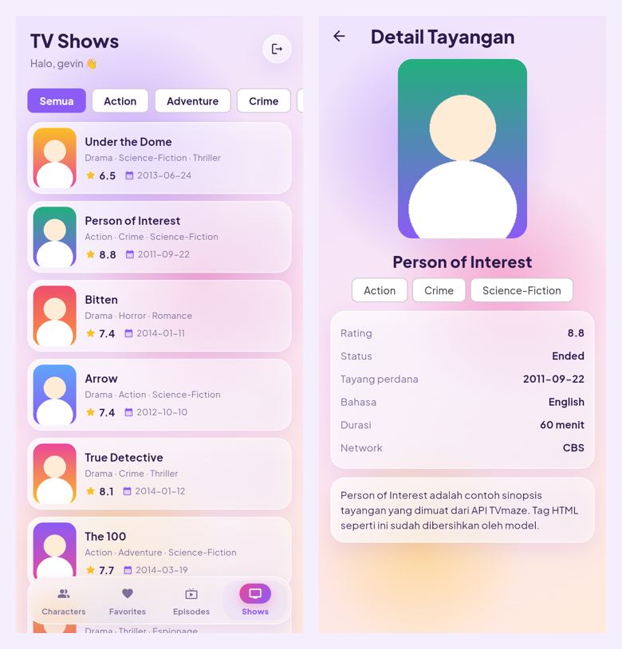

# Tugas: Tambahkan API TVmaze ke Project Rick & Morty

Tugas ini melatih hal yang paling mungkin keluar di responsi: **memasukkan API baru ke struktur yang sudah ada**. Kamu akan menambahkan tab keempat **"Shows"** berisi daftar tayangan TV dari API TVmaze, lengkap dengan filter genre dan halaman detail.

Bagian Rick & Morty yang sudah ada **tidak perlu diubah**. Kamu hanya menambah file baru dan menyambungkannya.

**Target hasil akhir:**



> Gambar di atas memakai data dan foto tiruan. Saat kamu jalankan, isinya poster dan data asli dari TVmaze.

**Cara mengerjakan:** ikuti langkah 1 sampai 7 secara berurutan. Setiap langkah punya petunjuk. Jawaban referensinya tersembunyi, jadi buka hanya setelah mencoba sendiri. Jawaban referensi ini sudah dicek dengan analyzer, dan model-nya diuji dengan contoh JSON di bawah.

---

## Mengenal API-nya dulu

| | |
| --- | --- |
| Base URL | `https://api.tvmaze.com` |
| List | `GET /shows` → 250 tayangan |
| Detail | `GET /shows/{id}`, misalnya `/shows/1` |
| Cari (bonus) | `GET /search/shows?q=girls` |
| API key | Tidak perlu |
| Bisa dari Chrome | Ya (CORS diizinkan) |

Buka `https://api.tvmaze.com/shows/1` di browser, lalu jawab 5 pertanyaan dari [`LATIHAN_API.md`](LATIHAN_API.md#bagian-a-5-pertanyaan-sebelum-menulis-kode) sebelum menulis kode.

Contoh respons `/shows` (dipotong, dua item). Item kedua **sengaja dibuat penuh `null`** untuk menunjukkan kasus yang memang ada di data asli: tayangan baru tanpa gambar, tanpa rating, atau tayangan streaming tanpa network.

```json
[
  {
    "id": 1,
    "url": "https://www.tvmaze.com/shows/1/under-the-dome",
    "name": "Under the Dome",
    "type": "Scripted",
    "language": "English",
    "genres": ["Drama", "Science-Fiction", "Thriller"],
    "status": "Ended",
    "runtime": 60,
    "premiered": "2013-06-24",
    "ended": "2015-09-10",
    "rating": { "average": 6.5 },
    "network": { "id": 2, "name": "CBS", "country": { "name": "United States", "code": "US" } },
    "webChannel": null,
    "image": {
      "medium": "https://static.tvmaze.com/uploads/images/medium_portrait/81/202627.jpg",
      "original": "https://static.tvmaze.com/uploads/images/original_untouched/81/202627.jpg"
    },
    "summary": "<p><b>Under the Dome</b> is the story of a small town that is suddenly sealed off.</p>"
  },
  {
    "id": 99999,
    "name": "Contoh Tayangan Streaming",
    "language": "Indonesian",
    "genres": [],
    "status": "In Development",
    "runtime": null,
    "premiered": null,
    "rating": { "average": null },
    "network": null,
    "webChannel": { "id": 1, "name": "Netflix" },
    "image": null,
    "summary": null
  }
]
```

Contoh respons `/search/shows?q=dome`, yang bentuknya **berbeda**:

```json
[ { "score": 0.91, "show": { "id": 1, "name": "Under the Dome", "genres": ["Drama"] } } ]
```

<details>
<summary><b>Cek jawaban 5 pertanyaan</b></summary>

1. **`[` atau `{`?** `/shows` diawali `[`, jadi array langsung (mirip mockapi, beda dengan Rick & Morty).
2. **List di key apa?** Tidak ada, karena respons-nya langsung list. Khusus `/search/shows`, setiap item membungkus data di key `show`.
3. **Pagination?** Ada (`/shows?page=1`), tapi halaman pertama (250 tayangan) sudah cukup. Tidak perlu infinite scroll.
4. **Tipe field yang perlu diwaspadai:**
   - `genres` adalah **list teks**.
   - `rating.average` bersarang, desimal, dan **bisa `null`**.
   - `image` bisa **`null`**. Kalau ada, gambarnya di `image.medium`.
   - `runtime` dan `premiered` bisa **`null`**.
   - `network` bisa `null`. Tayangan streaming memakai `webChannel`.
   - `summary` berisi **tag HTML** (`<p>`, `<b>`) dan bisa `null`.
5. **Detail?** Satu objek `{...}`, dengan bentuk sama seperti satu item di list.

</details>

---

## Langkah 1: Model `Show`

**Buat file:** `lib/app/data/models/show.dart`

**Field yang diminta:** `id`, `name`, `genres` (`List<String>`), `status`, `premiered`, `rating` (`double`, 0 kalau tidak ada), `imageUrl` (`''` kalau tidak ada), `summary` (tanpa tag HTML), `language`, `runtime` (`int`, 0 kalau tidak ada), `network`.

**Petunjuk:**

- Pakai contekan [Bagian B di LATIHAN_API.md](LATIHAN_API.md#bagian-b-contekan-pola-fromjson).
- `rating` bersarang: `json['rating']?['average']`.
- `image` bisa `null`, jadi perlu `?` sebelum `['medium']`.
- Menghapus tag HTML cukup dengan satu baris regex: `teks.replaceAll(RegExp(r'<[^>]*>'), '')`.
- Untuk `network`, coba `network.name` dulu. Kalau `null`, pakai `webChannel.name`.

<details>
<summary><b>Lihat jawaban Langkah 1</b></summary>

```dart
/// Model satu tayangan (TV show) dari TVmaze.
class Show {
  final int id;
  final String name;
  final List<String> genres;
  final String status;
  final String premiered;
  final double rating; // 0 jika belum ada rating
  final String imageUrl; // '' jika tidak ada gambar
  final String summary; // sudah dibersihkan dari tag HTML
  final String language;
  final int runtime; // menit, 0 jika tidak diketahui
  final String network;

  const Show({
    required this.id,
    required this.name,
    required this.genres,
    required this.status,
    required this.premiered,
    required this.rating,
    required this.imageUrl,
    required this.summary,
    required this.language,
    required this.runtime,
    required this.network,
  });

  /// "<p><b>Under the Dome</b> is ...</p>" -> "Under the Dome is ..."
  static String _stripHtml(String html) =>
      html.replaceAll(RegExp(r'<[^>]*>'), '').trim();

  factory Show.fromJson(Map<String, dynamic> json) => Show(
        id: (json['id'] as num?)?.toInt() ?? 0,
        name: json['name']?.toString() ?? '-',
        // List teks.
        genres:
            (json['genres'] as List?)?.map((e) => e.toString()).toList() ?? [],
        status: json['status']?.toString() ?? '-',
        // Bisa null untuk tayangan yang belum tayang.
        premiered: json['premiered']?.toString() ?? '-',
        // Bersarang DAN bisa null: { "rating": { "average": null } }
        rating: (json['rating']?['average'] as num?)?.toDouble() ?? 0,
        // 'image' sendiri bisa null, jadi pakai ?[ ].
        imageUrl: json['image']?['medium']?.toString() ?? '',
        summary: _stripHtml(json['summary']?.toString() ?? ''),
        language: json['language']?.toString() ?? '-',
        runtime: (json['runtime'] as num?)?.toInt() ?? 0,
        // Tayangan TV punya 'network', tayangan streaming punya 'webChannel'.
        network: json['network']?['name']?.toString() ??
            json['webChannel']?['name']?.toString() ??
            '-',
      );
}
```

</details>


---

## Langkah 2: Provider API kedua

**Buat file:** `lib/app/data/providers/tvmaze_provider.dart`

Kenapa tidak menambah fungsi ke `ApiProvider` yang sudah ada? Karena `baseUrl`-nya beda. Membuat provider terpisah membuat kode tetap rapi: satu provider untuk satu API.

**Tugas:**

- `getShows()` → `GET /shows`, kembalikan `List<Show>`.
- `getShow(int id)` → `GET /shows/{id}`.
- Tangani error seperti di `ApiProvider`. Kamu boleh memakai ulang class `ApiException` dari sana.

**Petunjuk:** respons berupa array langsung, jadi `jsonDecode(res.body) as List`.

<details>
<summary><b>Lihat jawaban Langkah 2</b></summary>

```dart
import 'dart:async';
import 'dart:convert';

import 'package:http/http.dart' as http;

import '../models/show.dart';
import 'api_provider.dart'; // memakai ulang ApiException

/// Provider KEDUA, khusus API TVmaze. Rick & Morty tetap di ApiProvider.
class TvmazeProvider {
  TvmazeProvider([http.Client? client]) : _client = client ?? http.Client();

  static const baseUrl = 'https://api.tvmaze.com';
  static const _timeout = Duration(seconds: 15);

  final http.Client _client;

  /// GET /shows -> ARRAY langsung: [ {...}, {...} ] (250 tayangan per halaman).
  Future<List<Show>> getShows() async {
    final body = await _get('/shows');
    return (body as List)
        .map((e) => Show.fromJson(e as Map<String, dynamic>))
        .toList();
  }

  /// GET /shows/{id} -> satu objek.
  Future<Show> getShow(int id) async {
    final body = await _get('/shows/$id');
    return Show.fromJson(body as Map<String, dynamic>);
  }

  /// BONUS. GET /search/shows?q=... -> bentuknya BEDA:
  /// [ { "score": 0.9, "show": { ...data tayangan... } } ]
  Future<List<Show>> searchShows(String query) async {
    final body = await _get('/search/shows?q=${Uri.encodeQueryComponent(query)}');
    return (body as List)
        .map((e) => Show.fromJson(e['show'] as Map<String, dynamic>))
        .toList();
  }

  Future<dynamic> _get(String path) async {
    try {
      final res =
          await _client.get(Uri.parse('$baseUrl$path')).timeout(_timeout);
      if (res.statusCode != 200) {
        throw ApiException('Server bermasalah (kode ${res.statusCode}).');
      }
      return jsonDecode(res.body);
    } on ApiException {
      rethrow;
    } on TimeoutException {
      throw const ApiException('Koneksi terlalu lama. Periksa internet kamu.');
    } catch (_) {
      throw const ApiException('Gagal terhubung ke server TVmaze.');
    }
  }
}
```

</details>


---

## Langkah 3: Daftarkan provider di `main.dart`

**Ubah file:** `lib/main.dart`

Provider baru harus didaftarkan ke GetX, supaya controller bisa mengambilnya dengan `Get.find()`.

<details>
<summary><b>Lihat jawaban Langkah 3</b></summary>

Tambahkan import:

```dart
import 'app/data/providers/tvmaze_provider.dart';
```

Lalu di `initDependencies()`, tepat di bawah `ApiProvider`:

```dart
Get.put(api ?? ApiProvider(), permanent: true);
Get.put(TvmazeProvider(), permanent: true);   // <- baris baru
```

</details>


---

## Langkah 4: Controller

**Buat file:** `lib/app/modules/show/show_controller.dart`

Isinya dua controller:

1. **`ShowController`** untuk halaman list:
   - State `shows`, `isLoading`, `errorMessage`, dan `selectedGenre` (`null` berarti semua).
   - Getter `genres`: daftar genre unik dari data, diurutkan.
   - Getter `filtered`: tayangan yang sesuai genre terpilih.
   - `fetch()` dipanggil di `onInit()`.
2. **`ShowDetailController`** untuk halaman detail: terima `Show` dari `Get.arguments`, lalu ambil data terbaru lewat `getShow(id)`.

**Petunjuk:**

- `genres` adalah list di dalam list. Untuk "meratakannya" pakai `expand`: `shows.expand((s) => s.genres)`.
- Filter dilakukan **lokal** dengan `where(...)`. Tidak perlu memanggil API lagi.
- Contoh polanya ada di `episode_controller.dart` (list sederhana) dan `detail_controller.dart` (detail).

<details>
<summary><b>Lihat jawaban Langkah 4</b></summary>

```dart
import 'package:get/get.dart';

import '../../data/models/show.dart';
import '../../data/providers/api_provider.dart';
import '../../data/providers/tvmaze_provider.dart';

class ShowController extends GetxController {
  final TvmazeProvider _api = Get.find();

  final shows = <Show>[].obs; // semua data dari API
  final isLoading = true.obs;
  final errorMessage = RxnString();
  final selectedGenre = RxnString(); // null = semua genre

  /// Daftar genre unik, diambil dari datanya sendiri (bukan ditulis manual).
  List<String> get genres =>
      shows.expand((s) => s.genres).toSet().toList()..sort();

  /// Data yang tampil setelah difilter. Filter dilakukan LOKAL, tanpa request.
  List<Show> get filtered {
    final genre = selectedGenre.value;
    if (genre == null) return shows;
    return shows.where((s) => s.genres.contains(genre)).toList();
  }

  @override
  void onInit() {
    super.onInit();
    fetch();
  }

  void selectGenre(String? genre) => selectedGenre.value = genre;

  Future<void> fetch() async {
    isLoading.value = true;
    errorMessage.value = null;
    try {
      shows.assignAll(await _api.getShows());
    } on ApiException catch (e) {
      errorMessage.value = e.message;
    } finally {
      isLoading.value = false;
    }
  }
}

/// Controller halaman detail tayangan.
class ShowDetailController extends GetxController {
  final TvmazeProvider _api = Get.find();

  final show = Rxn<Show>();
  final isLoading = false.obs;
  final errorMessage = RxnString();

  @override
  void onInit() {
    super.onInit();
    final args = Get.arguments;
    if (args is Show) show.value = args; // tampil dulu dari data list
    fetch();
  }

  Future<void> fetch() async {
    final id = show.value?.id;
    if (id == null) return;
    isLoading.value = true;
    errorMessage.value = null;
    try {
      show.value = await _api.getShow(id); // lalu GET /shows/{id}
    } on ApiException catch (e) {
      errorMessage.value = e.message;
    } finally {
      isLoading.value = false;
    }
  }
}
```

</details>


---

## Langkah 5: Halaman list dan detail

**Buat file:**

- `lib/app/modules/show/show_view.dart`: chip genre di atas, list tayangan di bawah (poster, nama, genre, rating, tanggal tayang).
- `lib/app/modules/show/show_detail_view.dart`: poster, nama, chip genre, info (rating, status, tayang perdana, bahasa, durasi, network), dan sinopsis.

**Petunjuk:**

- Bungkus dengan `Obx(...)`, lalu pilih tampilan sesuai state: loading → error → data. Polanya sama dengan `episode_view.dart`.
- Widget yang sudah ada bisa dipakai ulang: `GlassContainer`, `CharacterImage` (untuk poster), `LoadingView`, `MessageView`, dan `GlassScaffold`.
- Saat tayangan diklik: `Get.toNamed(Routes.showDetail, arguments: show)`.
- Rating 0 berarti belum ada rating, jadi tampilkan `-`.

<details>
<summary><b>Lihat jawaban Langkah 5: show_view.dart</b></summary>

```dart
import 'package:flutter/material.dart';
import 'package:get/get.dart';

import '../../data/models/show.dart';
import '../../routes/app_routes.dart';
import '../../theme/app_theme.dart';
import '../../widgets/character_widgets.dart';
import '../../widgets/glass.dart';
import '../../widgets/state_views.dart';
import 'show_controller.dart';

class ShowView extends GetView<ShowController> {
  const ShowView({super.key});

  @override
  Widget build(BuildContext context) {
    return Obx(() {
      if (controller.isLoading.value) {
        return const LoadingView(label: 'Memuat tayangan...');
      }
      final error = controller.errorMessage.value;
      if (error != null) {
        return MessageView(
          icon: Icons.wifi_off_rounded,
          title: 'Gagal memuat tayangan',
          message: error,
          onRetry: controller.fetch,
        );
      }
      final items = controller.filtered;
      return Column(
        children: [
          // Chip filter genre.
          SizedBox(
            height: 52,
            child: ListView(
              scrollDirection: Axis.horizontal,
              padding: const EdgeInsets.symmetric(horizontal: 16),
              children: [
                _GenreChip(
                  label: 'Semua',
                  selected: controller.selectedGenre.value == null,
                  onTap: () => controller.selectGenre(null),
                ),
                for (final genre in controller.genres)
                  _GenreChip(
                    label: genre,
                    selected: controller.selectedGenre.value == genre,
                    onTap: () => controller.selectGenre(genre),
                  ),
              ],
            ),
          ),
          Expanded(
            child: ListView.separated(
              padding: const EdgeInsets.fromLTRB(16, 4, 16, 100),
              itemCount: items.length,
              separatorBuilder: (_, _) => const SizedBox(height: 10),
              itemBuilder: (_, i) => _ShowTile(show: items[i]),
            ),
          ),
        ],
      );
    });
  }
}

class _GenreChip extends StatelessWidget {
  const _GenreChip({
    required this.label,
    required this.selected,
    required this.onTap,
  });

  final String label;
  final bool selected;
  final VoidCallback onTap;

  @override
  Widget build(BuildContext context) {
    return Padding(
      padding: const EdgeInsets.only(right: 8),
      child: Center(
        child: ChoiceChip(
          label: Text(label),
          selected: selected,
          onSelected: (_) => onTap(),
          showCheckmark: false,
          selectedColor: AppColors.purple,
          labelStyle: TextStyle(
            color: selected ? Colors.white : AppColors.text,
            fontWeight: FontWeight.w700,
          ),
        ),
      ),
    );
  }
}

class _ShowTile extends StatelessWidget {
  const _ShowTile({required this.show});

  final Show show;

  @override
  Widget build(BuildContext context) {
    return GlassContainer(
      radius: AppRadius.md,
      padding: const EdgeInsets.all(8),
      onTap: () => Get.toNamed(Routes.showDetail, arguments: show),
      child: Row(
        children: [
          CharacterImage(url: show.imageUrl, width: 60, height: 84),
          const SizedBox(width: 12),
          Expanded(
            child: Column(
              crossAxisAlignment: CrossAxisAlignment.start,
              children: [
                Text(
                  show.name,
                  maxLines: 1,
                  overflow: TextOverflow.ellipsis,
                  style: const TextStyle(
                    fontSize: 15,
                    fontWeight: FontWeight.w700,
                  ),
                ),
                const SizedBox(height: 4),
                Text(
                  show.genres.join(' · '),
                  maxLines: 1,
                  overflow: TextOverflow.ellipsis,
                  style: const TextStyle(
                    color: AppColors.textMuted,
                    fontSize: 12,
                  ),
                ),
                const SizedBox(height: 6),
                Row(
                  children: [
                    const Icon(Icons.star_rounded,
                        size: 16, color: AppColors.yellow),
                    const SizedBox(width: 4),
                    Text(
                      show.rating == 0 ? '-' : show.rating.toStringAsFixed(1),
                      style: const TextStyle(fontWeight: FontWeight.w700),
                    ),
                    const SizedBox(width: 12),
                    const Icon(Icons.calendar_month_rounded,
                        size: 14, color: AppColors.purple),
                    const SizedBox(width: 4),
                    Text(
                      show.premiered,
                      style: const TextStyle(
                        color: AppColors.textMuted,
                        fontSize: 12,
                      ),
                    ),
                  ],
                ),
              ],
            ),
          ),
        ],
      ),
    );
  }
}
```

</details>

<details>
<summary><b>Lihat jawaban Langkah 5: show_detail_view.dart</b></summary>

```dart
import 'package:flutter/material.dart';
import 'package:get/get.dart';

import '../../theme/app_theme.dart';
import '../../widgets/character_widgets.dart';
import '../../widgets/glass.dart';
import '../../widgets/state_views.dart';
import 'show_controller.dart';

class ShowDetailView extends GetView<ShowDetailController> {
  const ShowDetailView({super.key});

  @override
  Widget build(BuildContext context) {
    return GlassScaffold(
      appBar: AppBar(title: const Text('Detail Tayangan')),
      body: Obx(() {
        final show = controller.show.value;
        if (show == null) {
          return controller.errorMessage.value != null
              ? MessageView(
                  icon: Icons.wifi_off_rounded,
                  title: 'Gagal memuat detail',
                  message: controller.errorMessage.value!,
                  onRetry: controller.fetch,
                )
              : const LoadingView();
        }
        return ListView(
          padding: const EdgeInsets.fromLTRB(16, 4, 16, 32),
          children: [
            Center(
              child: CharacterImage(
                url: show.imageUrl,
                width: 180,
                height: 250,
                radius: AppRadius.md,
              ),
            ),
            const SizedBox(height: 16),
            Text(
              show.name,
              textAlign: TextAlign.center,
              style: const TextStyle(fontSize: 22, fontWeight: FontWeight.w800),
            ),
            const SizedBox(height: 8),
            Wrap(
              alignment: WrapAlignment.center,
              spacing: 6,
              runSpacing: 6,
              children: [
                for (final g in show.genres) Chip(label: Text(g)),
              ],
            ),
            const SizedBox(height: 12),
            GlassContainer(
              radius: AppRadius.md,
              padding: const EdgeInsets.all(14),
              child: Column(
                children: [
                  _row('Rating',
                      show.rating == 0 ? '-' : show.rating.toStringAsFixed(1)),
                  _row('Status', show.status),
                  _row('Tayang perdana', show.premiered),
                  _row('Bahasa', show.language),
                  _row('Durasi',
                      show.runtime == 0 ? '-' : '${show.runtime} menit'),
                  _row('Network', show.network),
                ],
              ),
            ),
            const SizedBox(height: 12),
            GlassContainer(
              radius: AppRadius.md,
              padding: const EdgeInsets.all(14),
              child: Text(
                show.summary.isEmpty ? 'Tidak ada sinopsis.' : show.summary,
                style: const TextStyle(height: 1.5),
              ),
            ),
          ],
        );
      }),
    );
  }

  Widget _row(String label, String value) => Padding(
        padding: const EdgeInsets.symmetric(vertical: 6),
        child: Row(
          children: [
            Text(label, style: const TextStyle(color: AppColors.textMuted)),
            const Spacer(),
            Text(value, style: const TextStyle(fontWeight: FontWeight.w700)),
          ],
        ),
      );
}
```

</details>


---

## Langkah 6: Route dan binding

**Ubah file:**

- `lib/app/routes/app_routes.dart`: tambah nama route `showDetail`.
- `lib/app/routes/app_pages.dart`: daftarkan `ShowController` di binding halaman `/main`, lalu tambah `GetPage` baru untuk halaman detail tayangan (jangan lupa `AuthGuard`).

<details>
<summary><b>Lihat jawaban Langkah 6</b></summary>

`app_routes.dart`:

```dart
static const showDetail = '/show-detail';
```

`app_pages.dart`, tambahkan import:

```dart
import '../modules/show/show_controller.dart';
import '../modules/show/show_detail_view.dart';
```

Di binding `Routes.main`, tambah satu baris:

```dart
Get.lazyPut(() => EpisodeController());
Get.lazyPut(() => ShowController());   // <- baris baru
```

Di akhir daftar `pages`, tambah:

```dart
GetPage(
  name: Routes.showDetail,
  page: () => const ShowDetailView(),
  middlewares: [AuthGuard()],
  binding: BindingsBuilder(() => Get.lazyPut(() => ShowDetailController())),
),
```

</details>


---

## Langkah 7: Tambah tab keempat di navbar

**Ubah file:** `lib/app/modules/main/main_view.dart`

Ada tiga tempat yang perlu ditambah:

1. `_titles`: tambah `'TV Shows'`.
2. `IndexedStack`: tambah `ShowView()` sebagai anak keempat.
3. `_FloatingNavBar`: tambah `_NavItem` keempat (index 3).

<details>
<summary><b>Lihat jawaban Langkah 7</b></summary>

Import:

```dart
import '../show/show_view.dart';
```

Judul:

```dart
static const _titles = ['Rick & Morty', 'Favorites', 'Episodes', 'TV Shows'];
```

Isi tab:

```dart
children: const [HomeView(), FavoriteView(), EpisodeView(), ShowView()],
```

Item navbar, letakkan setelah `_NavItem` Episodes (setelah tanda `),` penutupnya, **bukan di dalamnya**):

```dart
_NavItem(
  icon: Icons.tv_rounded,
  label: 'Shows',
  selected: index == 3,
  onTap: () => onSelected(3),
),
```

</details>


---

## Checklist selesai

Jalankan `flutter run -d chrome`, lalu cek satu per satu:

- [ ] Tab **Shows** muncul di navbar dan menampilkan daftar tayangan dengan poster.
- [ ] Saat memuat ada loading. Saat internet dimatikan muncul pesan error dan tombol **Coba Lagi**.
- [ ] Chip genre muncul otomatis dari data. Memilih "Horror" hanya menampilkan tayangan horor.
- [ ] Tayangan tanpa gambar atau rating **tidak membuat aplikasi crash**.
- [ ] Klik tayangan membuka detail. Sinopsis tampil **tanpa** tag `<p>` atau `<b>`.
- [ ] Tab Rick & Morty, Favorites, dan Episodes masih berfungsi seperti sebelumnya.
- [ ] `flutter analyze` tidak menampilkan error.

---

## Bonus (kalau masih ada waktu)

Urut dari yang paling mudah:

1. **Rating berwarna:** hijau untuk ≥ 8, kuning untuk ≥ 6, abu-abu untuk lainnya.
2. **Urutkan:** tombol di AppBar untuk mengurutkan berdasarkan rating tertinggi. Petunjuk: `list.sort((a, b) => b.rating.compareTo(a.rating))`.
3. **Pencarian:** pakai `searchShows(query)` yang sudah ada di jawaban Langkah 2. Ingat, bentuk responsnya `[{ "score": ..., "show": {...} }]`, jadi ambil `e['show']`. Pola debounce bisa dicontek dari `home_controller.dart`.
4. **Favorit tayangan di Hive:** box baru `show_favorites`, dengan `show.id` sebagai key. Tambahkan `toJson()` ke model `Show`, lalu ikuti contoh favorit Hive di [Latihan 7](LATIHAN_API.md#latihan-7-simulasi-responsi-lengkap-dummyjson-recipes). Ini persis yang diminta soal responsi film.

---

## Pola yang perlu diingat dari tugas ini

Setiap kali menambah API baru ke project yang sudah ada, urutannya selalu sama:

```
1. models/xxx.dart            ← bentuk data (fromJson)
2. providers/xxx_provider.dart ← panggil API
3. main.dart                  ← Get.put(provider)
4. modules/xxx/xxx_controller.dart ← state + logika
5. modules/xxx/xxx_view.dart  ← tampilan (Obx)
6. routes/                    ← daftarkan halaman + binding
7. main_view.dart / AppBar    ← tempat halaman itu dibuka
```
